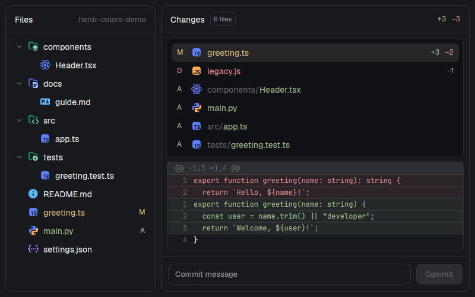

# File Changes Colorized

Separate **Files** and **Changes** panels with colored Charmed file/folder icons, Git status-colored filenames, syntax-highlighted file previews and green/red unified diffs. Changes keeps its file list and diff in separate bordered containers.



## Install

Ask your agent to read [RECIPE.md](RECIPE.md), then install either or both folders from `mods/` into `~/.config/herdr-app/mods/`. Do not overwrite an existing mod name. Each panel docks independently on first discovery; no layout or keys file is needed. The installed Files and Changes panels and their toolbar buttons stay untouched.

**Access:** reads the focused folder and runs Git plus shell/PowerShell commands. **Changes' Commit action stages every change with `git add -A` before committing.** It does not push. Review the recipe before installing.

## Verify

Tested with Herdr 0.1.9:

```sh
herdr-app check mods/file-changes-colors
herdr-app check mods/changes-colors
node tests/appearance.test.mjs
node tests/empty-diff.test.mjs
node tests/file-preview.test.mjs
```

Files uses Herdr's native syntax-highlighting editor. Changes highlights additions/deletions, not individual source tokens. Windows and remote-machine behavior were not tested. The real UI commit action was not exercised.

## Build from scratch

[RECIPE.md](RECIPE.md) describes the complete UI, interactions, APIs, bounds, installation, access and acceptance checks. This build adapts the Files and Changes mods bundled with Herdr 0.1.9. No external packages or icon fonts are required. Selected [Charmed icons](https://github.com/littensy/charmed-icons) come from [g-icons/github-icons](https://github.com/g-icons/github-icons/tree/e433d465e7170938fb671070805402abbb64d1a6/src/data/charmed), with open/closed variants for source, components, tests, docs, assets, config and scripts folders. Icons retain their original base palette. Each mod includes `CHARMED-LICENSE.md` (Copyright 2024 Littensy).
