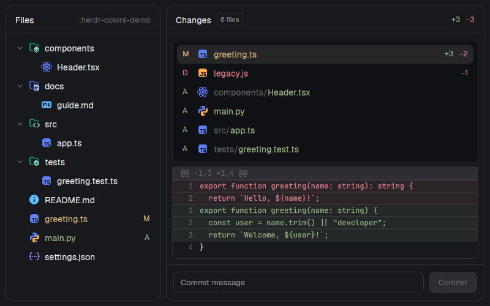

# File Changes Colorized

Two separate Herdr panels, Files and Changes, with full-color Charmed file/folder icons and Git-aware filenames. Files keeps its expandable tree and syntax-highlighted read-only code previews. Changes keeps its file list, green/red unified diffs, line numbers and commit controls, and adds a row of bordered Git buttons (Fetch, Pull, Push, Stash, Pop) with ↓/↑ counts for commits waiting to come in or go out. These are personal copies of the panels bundled with Herdr 0.1.9, not a replacement layout or a combined panel.



## What you see

### Files

A full-height panel with a theme-background surface, 1px theme border, 10px corners and 13px UI text. Its 42px header reads **Files** and shows the current folder name at the right. Below it, a scrollable tree has 28px rows, 18px indentation per level, 12px expansion chevrons, 16px icons and 7px gaps. Folders have distinct closed/open images; src/source, components, test/tests/__tests__, docs, assets, config and scripts use named folder icons. Each file has a type icon, its filename, and a Git status letter when applicable.

Use selected Charmed **base** SVGs from `g-icons/github-icons/src/data/charmed/base/icons/`. Show distinct TypeScript, React TypeScript, JavaScript, React, Java, Python, Rust and Go icons rather than generic code brackets. Other recognized source/config/image formats use their corresponding Charmed icons. README, license, Dockerfile, Makefile, Git dotfiles, package.json, package-lock.json, tsconfig.json and jsconfig.json get basename-specific icons. `.d.ts` gets typescript-def; `.env` and `.env.*` get config. Unrecognized names/extensions get `_file.svg`; an unrecognized folder gets `_folder.svg` or `_folder_open.svg`. Matching is case-insensitive. Preserve the SVGs' literal colors; do not tint them. This build uses the base palette in both light and dark appearances.

Git status colors override **filenames and status letters**, not Charmed icon colors: added/untracked A is green (`ansi2`), modified M yellow/amber (`ansi3`), deleted D red (`ansi1`), and conflicted U magenta (`ansi5`). Unchanged filenames use foreground. Exact hex values follow the person's theme. Deleted files do not appear in the filesystem tree; they remain visible in Changes. Parent folders do not aggregate descendant status.

Selecting a file replaces the tree with a read-only native code editor, 12px monospace, line numbers and folding. The header shows its relative path and a back arrow. Syntax colors: keywords magenta, strings green, comments dim, functions blue, types yellow, numbers red, constants cyan. Unsupported languages fall back to the native editor's behavior; binary files show an explanatory message, not an image preview.

### Changes

The same panel frame and 42px header, with **Changes**, a file-count badge and green/red addition/deletion totals. An 8px-padded body separates the file list and diff into two containers with an 8px gap. Both containers have 1px theme borders and 8px corners; the file list uses the theme chrome background. A scrollable changed-file list occupies 44–200px, using 28px rows. Each row shows a colored status letter, 16px Charmed type icon, dim parent path, status-colored filename and addition/deletion counts. The selected row uses the theme selection background; hovering uses the theme hover color.

Between the header and the body, a 40px Git row with a 1px bottom border, shown only inside a repository. On the left: a 14px muted branch icon and the 12px muted branch name (`detached HEAD` when detached, ` · no upstream` appended when the branch tracks nothing). On the right, five 28px-high bordered buttons, 7px corners, 6px apart, each a 14px Lucide icon with a tooltip: **Fetch** (refresh arrows), **Pull** (arrow down to a line), **Push** (arrow up from a line), **Stash** (archive box) and **Pop** (archive box with an up arrow). When the branch is behind its upstream, Pull shows `↓N` in bold 11px yellow (`ansi3`) with a yellow border and a faint yellow fill; when ahead, Push shows `↑N` the same way in blue (`ansi4`). Disabled buttons sit at 45% opacity; the running one shows `…` after its icon.

Below is a scrollable, virtualized unified diff with 20px rows and 11px monospace. Line numbers have a 30px gutter. Added text is green over a translucent green background; removed text is red over a translucent red background. Hunk headers use raised background and dim text. Context uses foreground. **Diff highlighting is addition/deletion highlighting, not per-token source-language highlighting.**

At the bottom, a commit-message field and 32px-high Commit button sit inside a 10px padded footer. The button stays disabled without a message, repository, or while loading/busy. There are no agent-status indicators in either panel: working, blocked, done and idle do not change these panels.

## How it behaves

- Each panel follows the focused terminal's working folder and machine, falling back to the active space's folder. Files lists that folder; Changes discovers its Git repository root. Switching context clears the previous selection and data. A non-Git folder still works in Files; Changes reports **Not a git repository**.
- Click a folder to expand/collapse it; collapsing removes expanded descendants. Click a file for its syntax-highlighted preview; the back arrow returns to the tree. Changes opens the first changed file automatically. Click another changed file to preview it; click the same row again to close its diff. Scrolling moves the lists/diff; hovering highlights rows. Nothing moves, pulses or animates by agent state.
- Local folders use `watchFolder` plus a 10-second refresh timer. Remote folders use the timer, with remote reads and commands routed to their machine. The mods make no network request themselves; Changes' Fetch, Pull and Push run git, which reaches the repository's remote. Existing Herdr machine connections may use the network.
- **Git row:** counts come from `git rev-list --left-right --count @{upstream}...HEAD` on every refresh, so they show what the last fetch saw; nothing fetches by itself. Fetch runs `git fetch --prune`. Pull runs `git pull --ff-only` and is disabled without an upstream; it never makes a merge commit and fails instead when the branches have diverged. Push runs `git push`, or `git push -u origin HEAD` when the branch has no upstream. Stash runs `git stash push -u` (untracked files too) and is disabled with no changes. Pop runs `git stash pop` and is disabled when no stash exists; its tooltip shows how many are saved. While one Git action or a commit runs, every button and Commit are disabled. A failure shows `<Action> failed: <git output>` in red under the body; the panel refreshes after every action. There is no confirmation, force push, rebase or merge.
- **Commit is a real write operation:** entering a message and pressing Enter or clicking Commit runs `git add -A`, then `git commit -m <message>` at the repository root. This stages ALL changes, including unrelated and untracked files. There is no staging picker, confirmation, discard or rollback; Push is a separate button. Commit hooks can run programs. On failure the panel shows an error; staging may already have happened. Escape leaves the message field's focus without committing.
- No global shortcuts or `keys.json` snippet are required. Normal Herdr pane/docking controls and native editor selection/copy still apply. Keep these as two independently docked panels, not tabs inside a new combined panel.

## Built from

### Folder to build

```text
RECIPE.md
preview.png
mods/
  file-changes-colors/
    main.js
    mod.json
    appearance.js
    chevron-down.svg
    chevron-right.svg
    CHARMED-LICENSE.md
    icons/          selected file icons and open/closed folder icons
  changes-colors/
    main.js
    mod.json
    appearance.js
    changes.svg
    branch.svg fetch.svg pull.svg push.svg stash.svg unstash.svg   Lucide icons for the Git row
    CHARMED-LICENSE.md
    icons/          selected file icons
```

Tests and a short README may accompany this build. Do not create or distribute a `layouts/` folder. Both manifests are `{"place":"right","size":368}`: first discovery docks each independently on the right. The screenshot places the two panels side by side in a temporary preview window; it does not require or ship that window's layout.

### Implementation

Read the current `AGENTS.md`, `herdr.d.ts` and `gpui-kit.d.ts` in the person's Herdr home. The installed type definitions, not browser/Node APIs, define the runtime. Default-export one `View` class from each `main.js`. Use `div`/`svg`/`image` from `gpui-kit` and flex builders plus native controls from `gpui-base`. Render Charmed SVG assets with `image(path).size(16)` so their original multicolor fills survive; reserve tinted `svg` for the expansion chevrons.

Start from the installed Files and Changes implementations when compatible, copying them into the new names before editing. Never alter the shipped originals. Rewrite all `mods/files/` and `mods/changes/` asset paths to their new folders. Neither copy uses props, embeds another mod, or calls a shipped mod at runtime; both are self-contained. `changes.svg` is a retained stock asset; the current Changes header is text, not that image.

Each copy carries its own pure `appearance.js` with the same file/status helpers, so it can be installed alone. Files additionally exports `folderAppearance(path, open)` for named and default closed/open variants. `gitStatus(xy)` classifies two-character porcelain status, prioritizing conflicts (`U`, `AA`, `DD`), then deletion, then added/untracked, then modified. `statusColor` maps that status to theme tokens. `fileAppearance` lowercases the basename and returns `{icon}` for the Charmed SVG basename. Use basename mappings before extension mappings, special-case `.d.ts` and `.env.*`, and fall back to `_file`. Copy only mapped icons into each mod's `icons/` folder; copy folder assets only into Files. No system icon fonts or runtime downloads. Preserve `CHARMED-LICENSE.md` verbatim in each mod (Copyright 2024 Littensy, MIT-style permission and notice requirements), and link the upstream collection in README. Source pinned for this build: https://github.com/g-icons/github-icons/tree/e433d465e7170938fb671070805402abbb64d1a6/src/data/charmed. The icons' own license, not just the extension's license, applies.

Files uses `spaces`, `panes`, `focused`, `exec`, `readTextFile`, `watchFolder`, `theme`, `settings`, and `window`. Lazily enumerate folders using quoted POSIX `sh` arguments, or PowerShell on local Windows, omitting .git and not descending directory symlinks. Read status with `git rev-parse --show-toplevel` and `git --no-optional-locks -c core.fsmonitor=false status --porcelain=v1 -z --no-renames --untracked-files=normal`; preserve NUL-delimited paths. Key marks by absolute repository paths so a focused subdirectory works. Use `EditorState.new`/`Editor.new`, not HTML or a terminal, for previews. Map ts/tsx/mts/cts/jsx/mjs to js, toml to yaml, jsonc to json, svelte/vue to html; otherwise pass the extension. Use a readonly editor with theme syntax colors.

Changes uses the same context/read/watch functions, plus `InputState`, `Input`, `Scrollbar` and `v_virtual_list`. Read porcelain status with `--untracked-files=all`. Compute stats with `git diff HEAD --numstat -z --no-renames`, or cached plus working-tree numstats before the first commit. Read tracked diffs using `--no-ext-diff --no-textconv --no-color`; use file contents for untracked/new files. Number the unified diff rows once from their hunk headers. Virtualize only nonempty rows; use an empty element otherwise. Read commands also set `diff.autoRefreshIndex=false` to avoid watch/refresh loops. Read the branch with `symbolic-ref --short -q HEAD`, the ahead/behind counts as above and the stash count from `git stash list`, alongside status. One runner, `git(cx, name, steps, done)`, executes a button's git argument lists in order at the repository root, stops at the first non-zero exit, records `name` as busy, and refreshes afterwards; Commit uses it too. The Git-row icons are Lucide outlines (`currentColor`, ISC license), drawn with tinted `svg(...).size(14)`.

Use `cx.spawn` and fresh callback contexts for asynchronous work, `cx.timer.every(10000, ...)` for refresh, and context keys to reject stale reads. Do not use Node APIs, HTML, CSS, setTimeout or top-level await in the mods. Tests may use Node separately.

### Installation and access

Before installing, tell the person: **these mods read files outside their own folders and execute Git plus a shell/PowerShell for directory listing. Changes can stage and commit every change in the selected repository, and its Git row fetches, pulls, pushes and stashes, which reaches the repository's remote.** They have the permissions of Herdr and the person's configured remote machines.

Copy either or both mod folders into the person's Herdr `mods/` directory. If a destination name exists, do not overwrite it: choose a new name and update its asset paths. Herdr docks each on first discovery. There is no key merge, layout switch or modification of shipped Files/Changes controls. Existing Files/Changes toolbar buttons still target the shipped panels; the copies occupy their own docked blocks. Users can keep/hide panels using Herdr's normal layout controls.

## Watch out

- On Herdr 0.1.9, the shipped Changes panel crashes `herdr-app check` when an empty `v_virtual_list` tries to get native keyed state without a current view. Do not materialize a virtual list or its scrollbar with zero rows. The included copy handles this; both mods pass check.
- Preserve limits: Files loads at most 500 entries per folder and 5,000 total, with a tree depth guard beyond 40; file preview keeps at most 400,000 JavaScript string units. Changes lists at most 1,000 files and displays at most 1,500 diff rows with at most 4,000 characters per line. Files warns when its list is capped; Changes warns about the file-list cap, not every diff truncation. Reading file text happens before preview truncation; these are display limits, not streaming memory guarantees.
- Files preview is a snapshot on selection; refresh does not reload an already-open preview. Reopen it for new content or rebuilt syntax colors after changing theme. There is no editing or save button.
- Git conflict precedence matters: AA and DD are conflicts, not ordinary additions/deletions. Status letters intentionally summarize index and worktree together; there is no staged/unstaged split. Renames are requested without rename detection and appear as deletion plus addition.
- Keep startup read-only. Never commit sample data through the real Changes panel. This build's screenshot uses only a disposable sample repository. It does not show image previews, code-token coloring inside diffs, or any hidden controls that a fresh build must invent. Remote and Windows paths retain the stock behavior but were not exercised for this build.

## Done when

1. `herdr-app check mods/file-changes-colors` and `herdr-app check mods/changes-colors` both exit zero; after opening them, `herdr-app status` reports no mod errors. For this build, checked on Herdr 0.1.9.
2. A real sample repository shows distinct source/config/Markdown icons and named closed folder icons in their original colors, green added filenames, amber modified filenames and red deleted filenames in Changes. Unknown extensions get Charmed's default file icon. Folder helper tests cover closed/open variants; asset tests check SVG palettes and attribution. Helper tests cover magenta conflicts and conflict precedence without modifying the person's repositories.
3. Expanding folders lists children; selecting a readable source file constructs a readonly native editor with syntax colors; returning to the tree works. Binary/unavailable content gets an explanatory message. Diff selection shows green additions/red deletions, line numbers and unchanged context; an empty diff does not crash the checker.
4. In a disposable repository with a remote: after two local commits Push shows `↑2`; pushing clears it. A commit pushed from another clone, then Fetch, shows `↓1` on Pull; Pull clears it. Stash empties the file list and enables Pop; Pop brings the files back. A branch with no upstream shows ` · no upstream`, disables Pull, and Push sets the upstream.
5. `node tests/appearance.test.mjs`, `node tests/empty-diff.test.mjs` and `node tests/file-preview.test.mjs` and `node tests/git-row.test.mjs` pass. Check commit behavior only in a disposable repository: the implemented action stages everything and commits the supplied message. This build did not execute the UI commit action against a real work repository.
6. The public package contains both mod folders, this recipe and a real `preview.png`, but no `layouts/` folder or private source/terminal captures. Its public GitHub repository has the `herdr-mod` topic.
