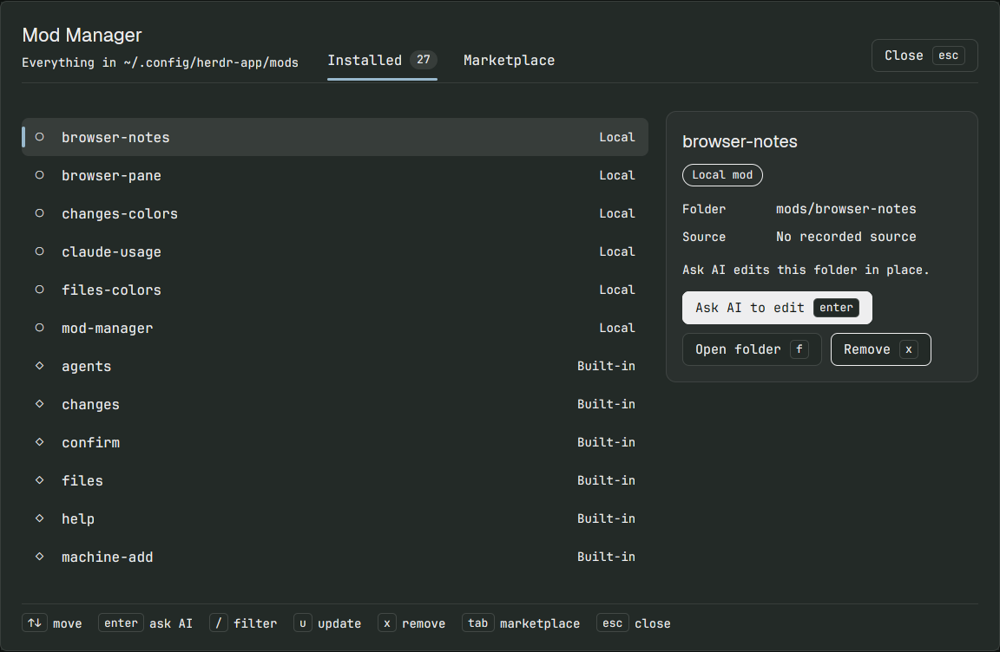

# Mod Manager

A dialog that manages Herdr app mods in one place. It lists every mod in `~/.config/herdr-app/mods` with an inspector beside it. It browses the Community mods (GitHub topic `herdr-mod`) and installs them after a review that says what each one does. It also updates and removes mods, and hands any mod to an AI agent in a new tab to change it. All text is in English. Text sizes are large and every text color meets WCAG 2.0 AA contrast.

## What you see

A centered overlay dialog, 60% of the window wide and 75% high. Herdr draws its frame. Inside, the theme `popover` background has 24px side padding, 20px top/bottom padding and 16px gaps. Base text is 15px. The dialog has four bands from top to bottom:

1. **Header**, with a 1px `border` line under it:
   - Left: **Mod Manager** (Geist, 22px, semibold). Under it, at 14px muted, either `Everything in ~/.config/herdr-app/mods` or `N update(s) available`.
   - Middle: two tabs, **Installed** and **Marketplace**, 16px semibold, 22px apart. Each tab has a count chip (22px tall, 11px radius, 13px text) and a 3px rounded underline. The active tab has `foreground` text, a `selected` chip and an `accent` underline. The inactive tab has muted text and no visible underline. The Marketplace chip shows only after the first search.
   - Right: a **Close** button with an `esc` keycap.
2. **Banner**, only when needed. It is a 10px-radius `raised` card, in one of three kinds:
   - Busy: a braille spinner (`⠋⠙⠹⠸⠼⠴⠦⠧⠇⠏`, 80ms a frame, `working` color) and text such as `installing claude-usage…`.
   - Confirm: a 2px border (`blocked` when the action deletes something, `accent` otherwise), a `?`, the question, and **Yes** `y` and **No** `n` buttons. Yes is red-outlined for a removal and solid otherwise.
   - Message: a 22px circled glyph (`✓` for success in `done`, `!` for an error in `blocked`, `i` for a note in `accent`), the text, and a **Dismiss** link on the right.
3. **Body**: two panes 20px apart. The list fills the left. The inspector, 360px wide, is on the right.
4. **Footer**, with a 1px `border` line above it. It shows the keys for the current screen as keycaps, each followed by a 14px muted word.

**Keycap:** 22px tall, 6px side padding, 5px radius, 1px `input` border, 13px semibold. **Button:** 38px tall, 14px side padding, 8px radius, 15px semibold, with its key drawn as a keycap after the label. Buttons come in three styles. Primary has a `solid` fill. Plain has a `popover` fill and an `input` border. Danger has a `blocked` border and `blocked` text.

### Installed tab

- **Filter box:** shown while you filter (46px tall, 10px radius). Its border is `accent` while typing.
- **List:** a virtual list with a scrollbar and 44px rows, each with an 8px radius:
  - A 4×24px `accent` bar shows only on the selected row.
  - A glyph: `●` (`done`) for installed by Mod Manager, `○` for a local mod, `◇` for one built into Herdr, `↑` (`blocked`) when an update is available.
  - The name, 16px, weight 600 when selected.
  - On the right, a 14px label: `Installed`, `Local`, `Built-in`, `· link` for a symlink, or `Update available`.
  - Rows are sorted by name, with Herdr's built-in mods last. The selected row has a `selected` background and rows have a `hover` background.
- **Inspector:** one `raised` card with 18px padding and 12px radius. From top to bottom:
  - The mod name (Geist, 20px).
  - A status pill (26px tall, 13px radius, outlined in its color): `Installed from GitHub`, `Local mod`, `Built into Herdr` or `Update available`.
  - Facts, each a 96px muted label beside a 15px value. For an installed mod: Source, Commit (`abc1234 → def5678` when an update is waiting), Installed date, Mods, Layouts and Keys. For other mods: Folder and Source.
  - A one-line note on what Ask AI will edit.
  - Buttons, in order: **Ask AI to edit** `enter` (primary), **Update** `u` (only when an update is waiting), **Open repo** `o` (only for a GitHub source), **Open folder** `f`, and **Remove** `x` (danger; not shown for built-in mods).

### Marketplace tab

- **Search box:** same look as the filter box.
- **Controls row:** a **Sort** button (`Most stars` or `Recently updated`), and on the right **‹ Prev**, `Page N of M` and **Next ›**.
- **List:** 44px rows with:
  - A `✓` when the repo is already installed.
  - The repo full name, 280px wide, truncated.
  - The description, muted.
  - `★ stars`.

  The list shows 10 rows a page.
- **Inspector:** the repo name, a pill (`Installed` or `Not installed`), a `★ stars` pill, the description, the Updated date, a note that installing opens a review first, and the buttons **Review & install** `enter` (or **Review update**) and **Open repo** `o`.

### Packages screen

This screen shows when a repo holds more than one package. It has the heading `<repo> has N packages`, the commit, and one 44px row per package: its folder (or `(root)`), its mods, its layout count, and `· no RECIPE.md` when it has no recipe.

### Review screen

- Heading `Install <name>` or `Update <name>`, with the repo under it.
- On the right: **Install/Update** `y` (hidden when blocked), **Open repo** `o` and **Cancel** `esc`.
- A muted warning: `Herdr does not review mods. Check the repository before installing one that runs programs or reaches the network.`
- Scrollable cards:
  - **Blocked** (only on a name clash, `blocked` border): the clashing names. Nothing is overwritten.
  - **What it adds:** the mods, the layouts (with a note that your layout is not switched), the file count, the commit, and `no RECIPE.md` when the recipe is missing.
  - **What the code does:** one `!` line for each finding (`runs programs`, `reaches the network`, `reads files`, `writes files`) with the files that do it. With no findings: a `✓ Runs no programs, reaches no network, reads and writes no files.` This card has a `blocked` border when there are findings.
  - **Keys:** `+ key → action (section)` for each key it adds, `= key stays <yours>; the mod wanted <action>` for each conflict, or `None.`

## How it behaves

The dialog does not show agent statuses (working, blocked, done, idle). It only uses the theme's `working`, `blocked` and `done` colors for its spinner, warnings and successes.

**Opening:** `ctrl-shift-m` runs `mod.open:mod-manager`, and pressing it again closes the dialog. On open, the dialog takes keyboard focus, lists the mods, and checks each installed source with `git ls-remote <repo> HEAD`. A row turns to `↑ Update available` when that check finds a newer commit.

**Keys on the Installed tab:**

- `↑`/`↓` or `k`/`j` move. `g`/`home` jump to the first row and `G`/`end` to the last. The list scrolls so the selected row stays in view.
- `enter` or `a` opens the Ask AI box.
- `/` filters by name as you type. `enter` leaves the box and keeps the filter.
- `u` reviews an update. For a mod not installed here, it says why it can't be updated.
- `U` asks to update every mod with an update waiting.
- `x` asks to remove the selected mod.
- `f` opens the mod folder. `o` opens the repo page.
- `r` refreshes the list.
- `tab`, `m` or `2` switch to Marketplace.
- `esc` or `q` clears the filter first. With no filter, they close the dialog.

**Keys on the Marketplace tab:**

- `↑`/`↓` move. Moving past the last row goes to the next page, and moving past the first row goes to the previous page.
- `←`/`→`, `h`/`l` or `pageup`/`pagedown` change page.
- `s` toggles the sort. `r` reloads.
- `/` searches. `enter` in the box runs the search.
- `enter` on a row reviews it. `o` opens the repo.
- `tab`, `1`, `esc` or `q` go back to Installed.

**Keys on the Review screen:** `y` or `enter` installs. `o` opens the repo. `esc`, `n` or `q` cancel.

**Keys in a Confirm banner:** only `y` means yes. `enter` does nothing there: it is the list's Ask AI key, so `x` followed by a habitual `enter` must not remove a mod. `n` or `esc` mean no, which shows `Cancelled.`

While the dialog is busy, it ignores keys. While a text box has focus, `esc` leaves the box.

**Mouse:** clicking a row selects it, clicking a tab switches tabs, and every action has a button. Rows show a `hover` background and buttons drop to 88% opacity on hover. Clicking a button gives focus back to the dialog, so keys keep working.

**Ask AI:** the search area becomes a box with a 2px `accent` border, labelled `Ask AI to change <name>:`. Type the change and press `enter`. Mod Manager starts the first installed agent from `knownAgents()` in a new tab named `mod: <name>`, in the Herdr config folder, then closes the dialog. The agent's task:

- reads `AGENTS.md` and then makes the change at `mods/<name>`;
- for a built-in mod: clone it with `mod.clone` as `<name>-custom`, point the person's layout at the clone, and edit the clone;
- for an installed mod: a later update replaces local edits;
- for a symlink: the edit lands in the link target;
- keeps running `herdr-app check` until it passes, then says what changed.

**Install:**

1. Shallow-clone the repo into `.mod-manager-cache/`.
2. Find packages: every folder holding `mods/<name>/main.js`, either at the repo root or one folder per package.
3. Show the review.
4. On `y`, copy the mod folders and layouts in, and merge the package's `keys.json` into the person's without replacing any key they already use.
5. Run `herdr-app check` on each mod.
6. Post a toast (`mod installed` or `mod updated`) and a message. When a check fails, both say so.

**Update all:** updates without a review only those packages that have no name clash and no new risk since their install. The message lists every other package as `skipped (use u)`.

**Remove:**

- For an installed package: deletes its mods and layouts, and deletes each key it added only while that key still runs the same action.
- For a local mod: deletes the folder.
- For a symlink: removes only the link.
- Built-in mods can't be removed.

## Built from

- **Files:** `mods/mod-manager/` holds `mod.json`, `main.js` (the view) and `core.js`.
  - `mod.json`: `{"place": "none", "title": "Mod Manager", "overlay": {"kind": "dialog", "width": 0.6, "height": 0.75}}`.
  - `core.js` holds all the file and git work, with no Herdr imports. It takes an `io` object (`exec`, `readText`, `writeText`), so `test/core.test.js` runs it under `node --test` against real git.
- **Imports:**
  - `gpui-kit`: `View`, `div`, `uniform_list`.
  - `gpui-base`: `h_flex`, `v_flex`, `InputState`, `Input`, `Scrollbar`, `VirtualListScrollHandle`.
  - `herdr`: `exec`, `appHome`, `readTextFile`, `writeTextFile`, `shared`, `setShared`, `props`, `closeOverlay`, `notify`, `theme`, `run`, `knownAgents`.
- **props:** `overlay` (the id passed to `closeOverlay`), `start: "market"` to open on Marketplace, and `review: "<owner/repo>"` to open straight into a review.
- **State:** shared key `mod-manager.installed`, a list of `{source, prefix, sha, mods, layouts, keys, risks, at}`.
- **Herdr commands:** `mod.open:mod-manager` (the key) and `tab.new {name, folder, argv, task}` (Ask AI). The agent's task mentions `mod.clone`.
- **Programs:**
  - `git` (`clone --depth 1`, `rev-parse`, `ls-files`, `ls-remote`);
  - `gh api search/repositories` for the Marketplace, falling back to an anonymous `fetch` of the same URL;
  - `herdr-app check`, `mkdir`, `cp -R`, `rm`, `find`, `ls`;
  - `xdg-open` (falling back to `open`) for folders and repo pages.
- **Built-in mods:** read from the keys of `installed.json` in the config folder.
- **Risk scan:** regular expressions over the package's `.js`/`.mjs`/`.json` files:
  - `exec(`, `hc(` or `process.run` means "runs programs";
  - `fetch(` or `WebSocket` means "reaches the network";
  - `readTextFile(` or `watchFolder(` means "reads files";
  - `writeTextFile(` means "writes files".
- **Contrast:** a `readable(color, toward, backgrounds)` helper uses WCAG relative luminance. It moves a text color in 10% steps toward `foreground` until it reaches 4.5:1 against `popover`, `selected` and `raised`. The helper runs on every render, so it follows theme changes.
- **Art:** none. Glyphs are text characters.
- **keys.json:** `{"global": {"ctrl-shift-m": "mod.open:mod-manager"}}`.

## Watch out

- **Origin:** this is a port of speardragon's herdr-plugin-manager through jacksonpires/herdr-app-mod-manager (MIT; see `LICENSE`). Upstream is in Portuguese and binds the Mac-only `cmd-shift-m`. This build translates every string and binds `ctrl-shift-m`.
- **Self-update:** once copied in by hand, Mod Manager lists itself as `Local`. Do not install it over itself from upstream, because that would bring back the Portuguese strings.
- **Risk scan:** it is a text match, so it can report risks that aren't there but should not miss the listed calls. Mod Manager reports risks of its own: it runs programs, reaches the network, and reads and writes files.
- **`writeTextFile`:** it needs the file's current contents as its third argument. Read the file first.
- **Marketplace limits:** the totals are capped at 1000. Anonymous GitHub search allows about 10 searches a minute, while `gh` raises that to 30.
- **Clones:** a clone left by a dialog closed mid-install is deleted the next time the dialog opens, once it is over 60 minutes old.
- **Prev/Next buttons:** they have no keycaps, because the arrow keys page.
- **Agent pick:** Ask AI picks the first installed agent in `knownAgents()` order. It does not ask which agent to use.
- **Untested:** Windows and remote machines. Ask AI only started an agent tab; no agent change was checked.

## Done when

1. `herdr-app check mods/mod-manager` passes, and `herdr-app status` shows no errors. `node --test` in this folder passes all 10 tests in `test/core.test.js`.
2. `ctrl-shift-m` opens the dialog. Its list shows every folder in `mods/`, with built-in mods last and labelled `Built-in`.
3. `↓`, `/` followed by a name, and a mouse click each change the selection. The inspector follows the selection.
4. `tab` loads Community repos with the `herdr-mod` topic, 10 a page. `enter` on one opens a review with **What it adds**, **What the code does** and **Keys**.
5. `y` installs the package. A toast appears, and the row reads `● Installed`. `x` followed by `y` removes it again, along with the keys it added.
6. `enter` on a mod, a typed request, and `enter` again open a tab named `mod: <name>` running an agent. The dialog closes.
7. With a light theme and a dark theme, the muted text stays readable (4.5:1 or more).
